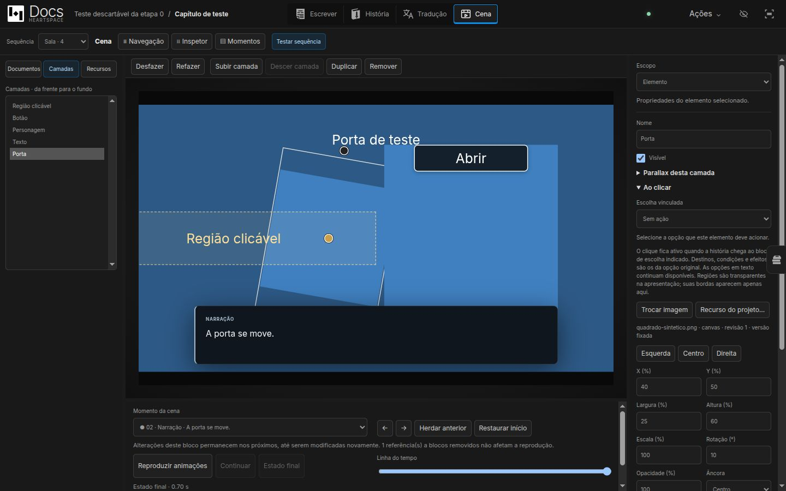
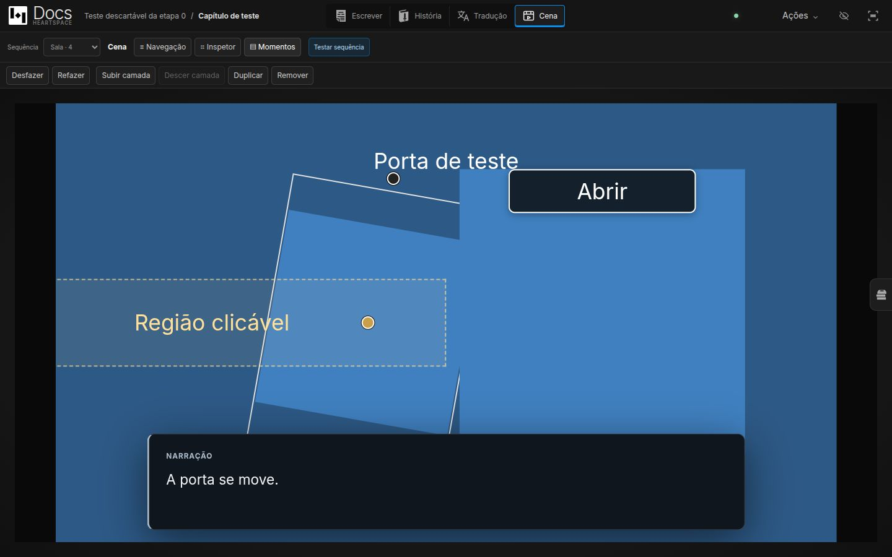
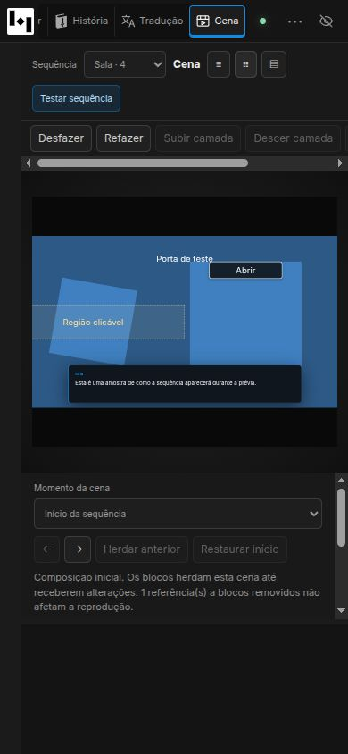

# A3 Organização do ambiente do Editor de Cena

**Data:** 25/11/2026. **Estado:** implementação local para avaliação do fundador.
**Referência de recuperação:** tag anotada `0.1.0-internal.1`, commit
`a9cdaa8af42dc7f637487c08c34eeb5df11921bb`. O fundador confirmou o push dessa
referência. A3 está isolada na branch `codex/docs-scene-a3`.

## Resultado implementado

O editor reaproveita os mesmos controles e suas rotas de autoria em seis regiões:

| Região | Conteúdo existente reorganizado |
|---|---|
| Barra superior | Sequência ativa, contexto, alternância dos painéis e teste da sequência |
| Painel esquerdo | Documentos (a navegação real do Docs), Camadas (lista existente) e Recursos (inserção/importação e seletor existente de recursos do projeto) |
| Barra de ferramentas | Desfazer/refazer de autoria e operações existentes de ordem, duplicação e remoção |
| Palco | Prévia/manipulação existentes, com prioridade do espaço central |
| Inspetor | Configuração por escopo e propriedades da seleção, incluindo interação/animação já disponíveis |
| Painel inferior | Seletor e navegação de momentos, comandos existentes de herança/restauração e reprodução temporal contextual |

Não há cópias sincronizadas de controles: os nós existentes são movidos, conservando
referências, eventos e identidade. A navegação documental e o seletor de sequência
retornam às suas posições originais ao sair de Cena. A lista de camadas permanece
plana, com seleção individual. Recursos não é um novo catálogo ou sistema de assets.
O painel inferior usa os momentos atuais; não introduz storyboard com miniaturas
nem um novo sistema de timeline/animação.

Painéis laterais e inferior podem ser recolhidos independentemente e redimensionados
por ponteiro ou separadores focáveis com teclado. As larguras se ajustam ao espaço
disponível para conservar o palco. Em janela estreita, as regiões passam para uma
coluna rolável, com limites de altura ajustáveis e recolhimento. A barra mantém
controles de reabertura; não é necessário alcançar um painel oculto para recuperá-lo.

Estados de painel, tamanho e contexto da aba esquerda são locais à página e não
entram no documento ou no histórico. Não são persistidos após recarregar. A prévia
continua dimensionada pelos mecanismos existentes, sem alterar coordenadas autorais.

## Escopos e foco

- **Experiência:** formato/orientação existentes, de alcance geral. Não muda o tema
  das ferramentas nem cria preferência de acessibilidade nova.
- **Cena:** composição inicial da sequência. Escolher esse escopo navega explicitamente
  para o início; não grava composição apenas por navegar.
- **Momento:** composição no bloco ativo. O seletor permite voltar ao último momento
  visitado disponível, ou ao primeiro disponível quando não há visita anterior.
- **Elemento:** propriedades da seleção atual. Sem seleção, o inspetor informa o
  contexto da composição ou oferece indicação para selecionar, sem propriedades fictícias.

A seleção existente acompanha trocas das abas laterais, recolhimento e alternância
Escrever/Cena no mesmo contexto. Trocas de momento/documento continuam respeitando
as regras já existentes do compositor; A3 não altera a política de seleção dessas
operações. Uma edição numérica/textual é finalizada pelas rotas A2 antes da navegação,
sem criar histórico só por mudar painéis ou escopos.

A busca de documentos passou a ficar dentro da superfície de Cena; seu teclado é
explicitamente excluído do roteamento do histórico de autoria. Ctrl+Z no campo de
busca não consome operações de Cena. Comandos autorais, atalhos e finalização de
rascunhos mantêm os guards A1/A2. A habilitação das operações de composição atua
somente sobre seus controles originais, sem desabilitar a navegação em contexto
sem permissão de edição.

As abas têm nomes, relação com seus painéis, indicação de seleção, foco visível e
navegação por setas/Home/End. Os controles de recolhimento mantêm nomes acessíveis
mesmo quando só os ícones aparecem. Os separadores informam orientação, limite e
valor atual; o inspetor associa a explicação do escopo ao seletor. Isso é cobertura
local de UI/teclado, não certificação com tecnologias assistivas.

## Arquivos alterados

- `scene-workspace.js`: coordenação privada da disposição dos controles e do estado
  de interface; não grava dados autorais.
- `assets/docs/scene-workspace.css`: disposição, hierarquia visual, foco e responsividade.
- `scene-composer.js`: contêiner sem o recolhimento antigo redundante, notificação
  privada de seleção e conjunto original de controles editáveis separado da navegação.
- `index.html`: carrega e monta o ambiente; preserva o encaminhamento dos controles
  existentes e protege o foco da busca documental.
- `desktop/loader.js`: resolve o caminho local do novo módulo. A folha de estilo usa
  a resolução já existente de assets. Nenhuma mudança no protocolo desktop.
- `ops/desktop-csp.txt`: somente hashes do inline atualizados; mesmas diretivas.
- `tests/prepare-stage0.cjs`: invalidação de cache do módulo de layout nas cópias de teste.
- `tests/stage0-editor-matrix.js`: seis casos específicos de A3, mantendo os 41 anteriores.
- Este relatório, índice dos testes e evidências visuais/resultados.

Nenhum contrato, formato persistido, migração ou dependência transversal foi
introduzido. Os módulos de formato, arquivo/recuperação, paginação A1 e patches de
histórico A2 foram comparados com a tag e permaneceram idênticos. Especificação e
complemento também permanecem byte a byte iguais. A4–A6 e B–E não foram executadas.
A exclusão de geração de arte por IA permanece integral.

## Validação executada

| Verificação | Resultado real |
|---|---|
| Bateria automatizada existente | 119/119, sem falhas |
| Matriz de editor ampliada | 47/47, sem falhas: 41 anteriores e A3-01–06 |
| Fechamento de aba e reabertura | Passou; corpo preservado, undo/redo vazios |
| Teclado real no inspetor | X editado para 47, Ctrl+Z para 40, Ctrl+Shift+Z para 47; foco permaneceu no campo |
| Redimensionamento por ponteiro real | Painel esquerdo de 224 para 250 px |
| Capturas de janela | 1440×900, 1000×760 e 390×844, com estados abaixo |
| Sintaxe, scripts inline e diferenças | Sem erro de sintaxe; diff sem erros |
| Fixture desktop | Módulo e CSS carregados pelos caminhos ../../; nenhum erro observado no navegador. Não certifica Core real ou publicação |

A3-01 cobre regiões e troca Documentos/Camadas/Recursos sem alteração autoral;
A3-02 cobre recolhimento e redimensionamento por teclado, incluindo mudança visual
de dimensão; A3-03 cobre rascunho de nome, navegação e undo/redo; A3-04 cobre escopos
sem gravação; A3-05 protege o foco da busca; A3-06 verifica gravação e desfazer/refazer
pelos controles gerais realocados. Os casos anteriores cobrem manipulações existentes,
ordem cronológica, documentos/projetos, cópia portátil, recuperação e reabertura.

As baterias de navegador 11/11 de compatibilidade e 24/24 de recuperação permanecem
como referências aprovadas anteriores; não foram repetidas como auditoria geral.
Foram usados apenas documentos sintéticos e cópias de teste. Não houve acesso a
projetos autorais reais nem publicação de dados para validar a interface.

Resultados completos: [matriz](tests/evidence/stage-a3-editor-2026-11-25.json),
[fechamento](tests/evidence/stage-a3-close-reopen-2026-11-25.json) e
[resumo e hashes](tests/evidence/stage-a3-results-2026-11-25.json).

## Capturas reais

Capturas do editor implementado, sem sobreposição do painel de automação e sem
montagens. Os elementos são do corpus sintético, inclusive sua referência órfã
intencional, que continua sendo comunicada pelos controles existentes.

| Captura | Janela e estado |
|---|---|
| [Sem seleção](tests/evidence/a3-visual/1440-no-selection.png) | 1440×900, composição inicial e propriedades da cena |
| [Elemento selecionado](tests/evidence/a3-visual/1440-element-selected.png) | 1440×900, momento e inspetor do elemento |
| [Painéis recolhidos](tests/evidence/a3-visual/1440-panels-collapsed.png) | 1440×900, palco com os três painéis recolhidos |
| [Janela intermediária](tests/evidence/a3-visual/1000-inspector.png) | 1000×760, navegação recolhida e inspetor disponível |
| [Tela estreita](tests/evidence/a3-visual/390-stage.png) | 390×844, palco e momentos em coluna, laterais recolhidas |

## Limitações e pendências

A3 organiza a cobertura atual; não amplia a cobertura funcional do histórico A2.
Continuam suas exclusões e o limite de 60 entradas em memória, H07, as limitações
ambientais de seletor nativo/IME/tecnologias assistivas e o alcance não certificado
do Core real. Não há seleção múltipla, grupos persistentes, bloqueio novo,
blocagem, herança explícita ou exploração persistente.

A barra global de áreas conserva a rolagem horizontal existente quando falta
espaço em janelas pequenas. Painéis estreitos têm rolagem própria para manter
acesso a propriedades longas. A preferência de organização não é salva entre
recargas. Esses limites não impedem os fluxos locais validados.

Cópia de recuperação fisicamente independente e falha SSH continuam pendências
operacionais não bloqueantes da entrega anterior; não houve alterações de
credenciais. Nenhuma questão de contrato compartilhado precisou ser aplicada ou
encaminhada nesta parcela local.

## Consolidação versionada proposta

Recomendo **0.1.0-internal.2**, incremento da versão interna contendo exclusivamente
A3 e suas evidências. Manter `0.1.0-internal.1` como recuperação e registrar um commit
identificável para o ambiente de Cena, seus testes e documentação. A proposta de
mensagem é `feat(scene): organize A3 workspace and contextual panels`.

Após aprovação, conferir somente o pacote derivado desse commit, incluindo o novo
módulo e CSS, com manifesto e prévia local. O empacotador atual está fixado na versão
anterior; sua parametrização de metadados será uma atividade de preparação da nova
release, não uma mudança funcional antecipada nesta parcela.

A branch de A3 contém a implementação ainda não consolidada em commit/tag de release.
Não houve push ou publicação hospedada. A próxima autorização deve delimitar a
consolidação e distribuição de A3; não implica início de A4.
